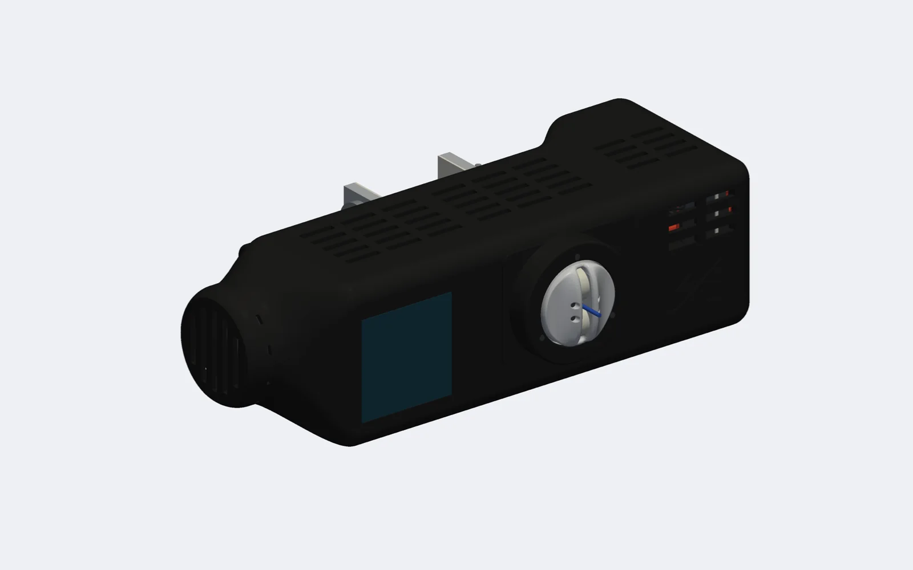

<h1 align="center">Kinetiq Gym</h1>

<b>A programmable smart gym, built as open hardware.</b> 
<a href="https://kinetiqgym.com">kinetiqgym.com</a> · <a href="https://kinetiqgym.com/build">The build</a> · <a href="https://kinetiqgym.com/build#parts">Parts &amp; cost</a> · <a href="https://kinetiqgym.com/build#software">App</a> · <a href="https://kinetiqgym.com/#support">Support</a> · <a href="docs/roadmap.md">Roadmap</a> · <a href="https://kinetiqgym.com/#join">Follow the build &amp; kit waitlist</a>

A direct-drive motor turns a rope drum, a geared rope guide lays the rope, and the controller sets the resistance in software.
It mounts on a rack upright. The design is built to be trained with, built, modified and programmed.

> **Status: open hardware in development. CAD only: nothing is built in metal or load-tested yet.** The current design, V1,
> is drawn in CAD and still under review; a 3D-printed prototype of the earlier design is on the bench. **The CAD, build
> files and software are released after a prototype has been built and load-tested**, so what you download is something
> that has actually worked. Until then, this repository holds the website, the documentation and the pictures.

| | |
|---|---|
|  |  |
|  |  |

The picture at the top is a quick CAD preview of V1. The renders below show the earlier design (Blender); the display
content is illustrative.

## What it does

- **Programmable resistance:** a motor and a cable drum stand in for the weight stack, so the load is set in software.
- **Adjustable position:** it hangs on a rack upright at the height you want, and the cable exit swivels to follow the pull.
- **Training modes in software:** eccentric, chain-style and band-style resistance are designed as modes, not attachments.
- **Customizable hardware:** one frame with a lineup of stock motors, battery or wall power, and documented interfaces for your own.
- **Local and hackable:** its own controller and a Raspberry Pi, with no account or cloud service in the loop.

## The builds

V1 is the current design: an off-the-shelf motor turns a 1 in drum directly, with no belt or gear between them, inside a box of
five 3/8 in aluminum plates. Nothing is welded or turned on a lathe. The other four builds are V1 with a few parts swapped.
Parts lists and prices so far are on the [build preview](https://kinetiqgym.com/build#parts).

| Build | Status | Pull | Motor and controller | Power | Mount |
|---|---|---|---|---|---|
| V1 | CAD, not built yet | up to about 180 lb (design estimate) | APS 8072S, ODrive Pro | 10S battery (2 x 5S LiPo) | rack upright, quick release |
| V1 (220 battery) | CAD first look | 220 lb is the design target; not yet calculated | Hobbywing XRotor V11130, Flipsky 75200 | 10S battery | rack upright |
| V1 wall power (220) | CAD first look | 220 lb is the design target; not yet calculated | APS 8072S, ODrive Pro with a regen clamp | 48 V, 1,000 W wall supply | rack upright |
| V1 budget wall power | CAD first look | to come | APS 8072S, ODESC V4.2 | 48 V, 600 W wall supply | rack upright |
| V1 wall mount (300) | CAD first look | 300 lb is the design target; not yet calculated | Hobbywing XRotor V11130, Flipsky 75200 | 48 V, 1,000 W wall supply | wall studs |

Nothing is built in metal or load-tested, so there are no ratings here: every number is a design estimate. The motors' torque
against current and the controllers' currents are still to be bench-tested. The reference pages under `docs/` still describe
the earlier design (October 2026) and are marked so; they are rewritten for V1 as it is confirmed.

## In this repository

| Path | What |
|---|---|
| `site/` | kinetiqgym.com: the front page, the build preview, the parts data (`site/data/`) and the reference docs (`site/docs/`) |
| `src/worker.js` | the Cloudflare Worker behind the site: the build list and the project form |
| `docs/` | build order, wiring, printing, modifying, setup and roadmap (drafts until testing) |
| `bom/BOM.md` | the bill of materials |
| `SAFETY.md` | read before building or powering anything |
| `LICENSE.md`, `LICENSES/` | the licences, and the reserved name and logo |
| `AGENTS.md` | instructions for AI coding agents working on this repository |

**Not here yet:** CAD (STEP, DXF, editable source), print files, and the Pi, Teensy and phone software. They are released
together after testing.

## Kits

Metal kits (the frame plates, the drum parts, the rope exit and the rack mount, ready to bolt together) are planned once a
prototype passes load testing. Nothing is for sale yet. [Join the kit waitlist](https://kinetiqgym.com/#join).

## Support and contributions

The CNC machine is already in the workshop; support now goes to prototype iterations and build support
([support the project](https://kinetiqgym.com/#support)). **Contributions are closed until the verified release**: see
[CONTRIBUTING.md](CONTRIBUTING.md).

## Licence

For the verified release: hardware under CERN-OHL-S-2.0, documentation under CC BY-SA 4.0, software under GPL-3.0. The
**KINETIQ** and **Kinetiq Gym** names and logo are not licensed: only the maker sells kits and machines under them. Details in
[LICENSE.md](LICENSE.md).

**This is an untested prototype, not a finished exercise product.** Read [SAFETY.md](SAFETY.md).
